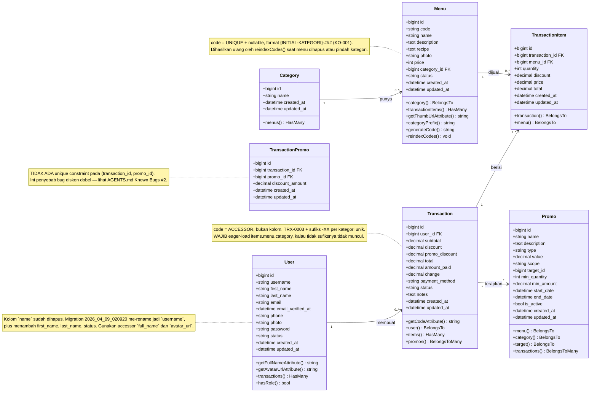
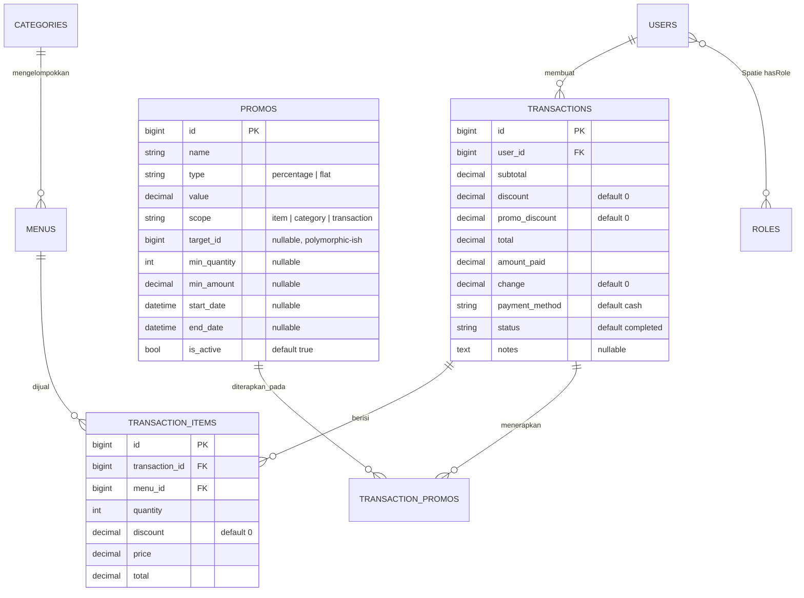
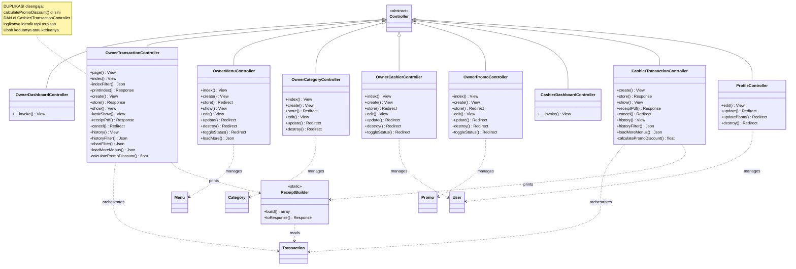
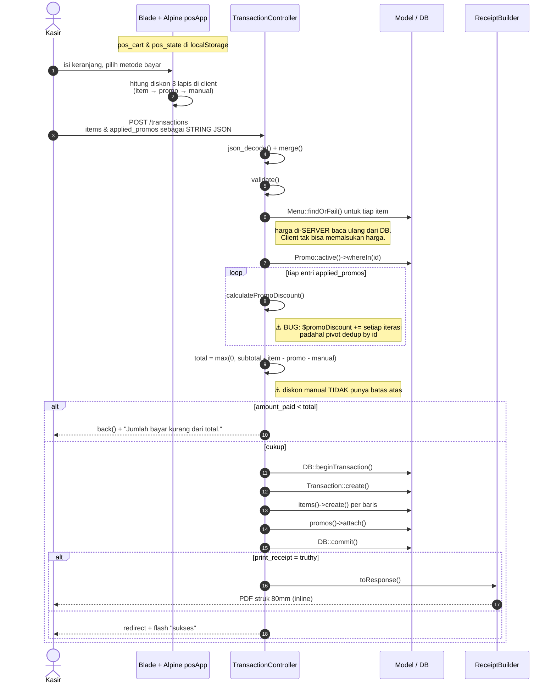

# Class Diagram — Hideout Coffee POS

Disusun dari kode sumber (`app/Models`, `app/Http/Controllers`, `app/Support`, `database/migrations`).
Render otomatis di GitHub/GitLab/Obsidian, atau di VS Code pakai ekstensi *Markdown Preview Mermaid Support*.

> **Catatan penting:** kolom di bawah adalah **skema database nyata hasil migrasi** (termasuk hasil
> `ALTER`Zones setelahnya), bukan `$fillable`. Yang menentukan apakah sebuah kolom bisa diubah Request ada di
> properti `$fillable` tiap model — keduanya sengaja dibedakan.

---

## 1. Domain Model (Eloquent + skema tabel)

Ini bagian paling penting. Struktur data inti POS beserta relasinya.

### Tabel pivot `transaction_promos`

Bukan model Eloquent — tabel murni yang diakses via `Transaction::promos()` dengan `withPivot('discount_amount')`.

> ⚠ `PROMOS.target_id` **bukan foreign key**. Nilainya mengacu ke `menus.id` bila `scope = 'item'`,
> atau `categories.id` bila `scope = 'category'`. Tidak ada constraint DB — integritas dijamin hanya oleh
> logika `Promo::target()`. Menarik relasi ini lewat `$promo->menu` / `$promo->category`.

---

## 2. Lapisan Controller

Kimat memetakan controller → model yang dipakai, plus method yang tidak aman.

> ⚠ `Owner\TransactionController::page()` **tidak mengirim `$categories`** ke view, padahal
> `page.blade.php:61` membutuhkannya → HTTP 500. Saudaranya `create()` (`:363`) mengirimnya dengan benar.

---

## 3. Alur utama: `store()` (checkout POS)

Berlaku identik untuk `Owner` dan `Cashier` (duplikat disengaja agar laporan/the ownership berbeda).

---

## 4. Peta Ownership (kompleksitas siklikal)

Untuk pembaca yang masuk lewat halaman shared dan bingung "file mana yang asli?".

| Method | Render view | Scope data |
|---|---|---|
| `Owner::history()` / `historyFilter()` | `cashier.transactions.history` | `Auth::id()` — **milik owner sendiri** |
| `Owner::index()` / `indexFilter()` | `owner.transactions._data_table` | **Global** (semua transaksi) |
| `Owner::show()` | `owner.transactions.show` | Global, **tanpa** cek `user_id` |
| `Owner::kasirShow()` | `cashier.transactions.show` | Global, **tanpa** cek `user_id` |
| `Cashier::show()` / `receiptPdf()` / `cancel()` | `cashier.transactions.show` | `Auth::id()`, **403** bila bukan milik sendiri |

⚠ **`Owner\TransactionController::page()` bukan bagian dari pola ini.** Tab "Riwayat" di halaman itu
adalah **tabel inline terpisah** di `owner/transactions/page.blade.php`, bukan partial
`_history_table`. Edit `_history_table` **tidak** otomatis tercermin di sana — harus disinkronkan manual.

---

## Legenda

- **Panah `→`** = asosiasi / pemanggilan
- **Panah `..>`** = dependensi lemah (controller memakai model)
- **`<|--`** = pewarisan
- **Angka kardinalitas** = `1`, `*` (nol atau lebih), `0..*`
- **Kotak kuning** = catatan jebakan / tempat yang mudah salah
