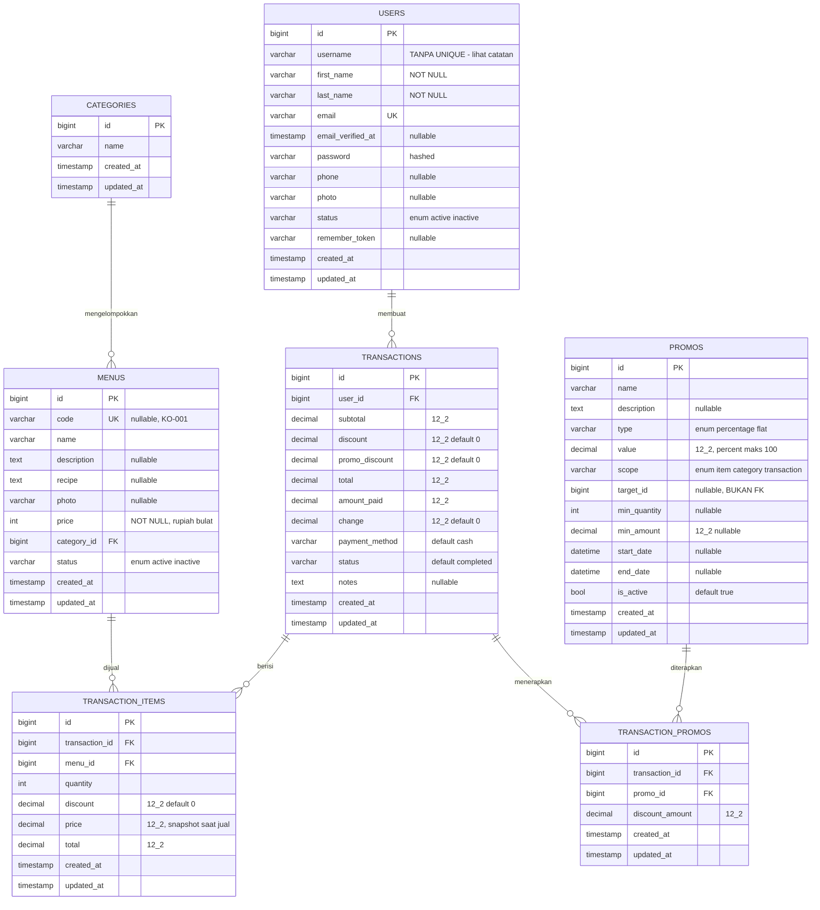
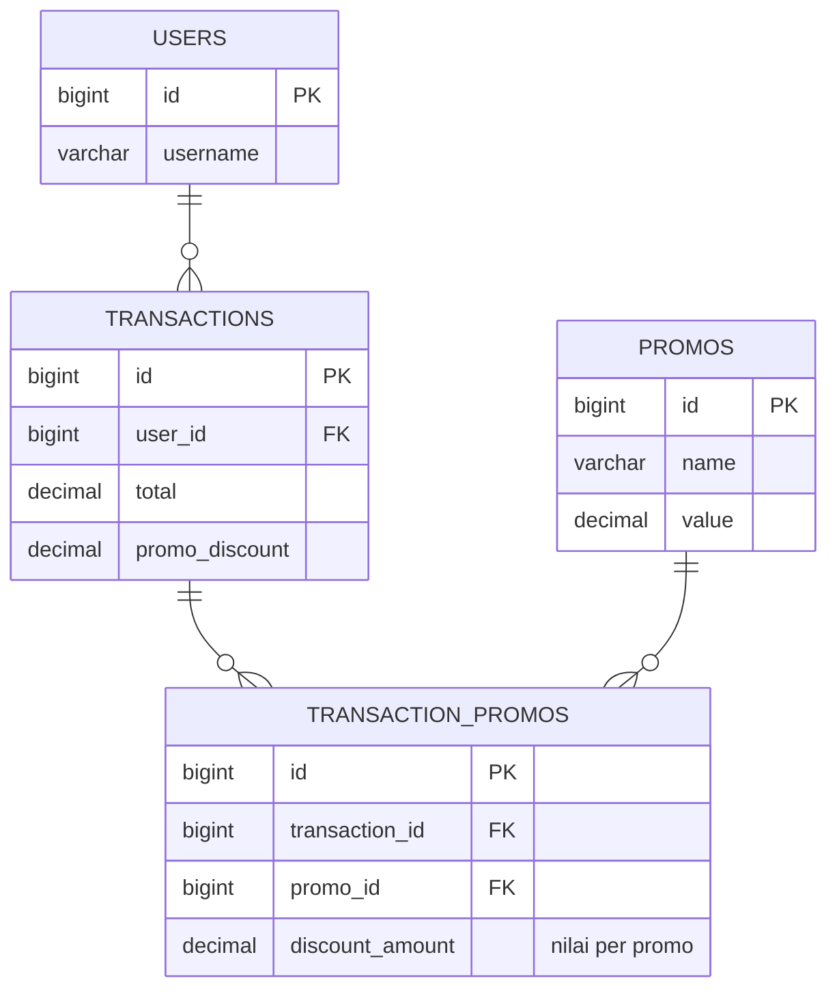
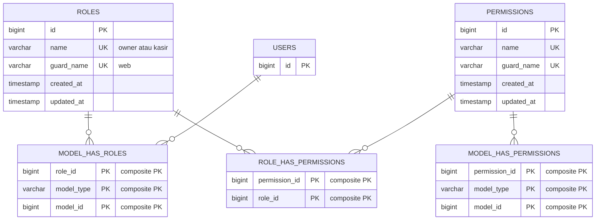
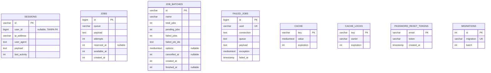

# ERD — Hideout Coffee POS

Skema database **MySQL `hideout_coffe`**, diambil dari `SHOW CREATE TABLE` (tabel yang sudah ada di DB dev)
dan dari hasil menjalankan seluruh 19 migrasi pada DB SQLite sekali-pakai untuk tabel domain yang belum
dimigrasikan di DB dev.

> ⚠ **DB dev sedang tidak lengkap.** Hanya 5 dari 19 migrasi yang sudah jalan (`migrations` table, batch 1):
> `create_users`, `create_cache`, `create_jobs`, `modify_users_table`, `create_permission_tables`.
> Tabel domain (`categories`, `menus`, `transactions`, `transaction_items`, `promos`, `transaction_promos`)
> **belum ada** di `hideout_coffe` — POS akan error sampai `php artisan migrate` dijalankan.
> `users.phone` dan `users.photo` juga belum ada di sana karena migrasinya belum dijalankan.

Render di GitHub/GitLab/Obsidian, atau di VS Code dengan ekstensi *Markdown Preview Mermaid Support*.

---

## 1. Domain Inti (tabel aplikasi)

---

## 2. Relasi Ganda (pivot)

`transactions` ↔ `promos` **many-to-many**, dimediasi lewat `transaction_promos` yang menyimpan nilai diskon
hasil perhitungan saat transaksi itu dibuat.

⚠ **Tidak ada `UNIQUE (transaction_id, promo_id)`.** verified di `SHOW CREATE TABLE` — hanya `PRIMARY KEY (id)`
dan dua foreign key. Inilah akar bug diskon dobel: `store()` menjumlahkan `$promoDiscount` di tiap iterasi
sementara array pivot di-*deduplicate* by id, jadi satu promo bisa dibayar berkali-kali namun hanya tertulis
satu baris pivot. Lihat `AGENTS.md` → *Known Bugs* #2.

---

## 3. RBAC (Spatie Permission)

`User::hasRole()` dibaca dari sini lewat trait `HasRoles`. Tabel `permissions` sebenarnya tidak dipakai
aplikasi ini — hanya 2 role yang benar-benar ada (`owner`, `kasir`).

> `model_has_roles` memakai **composite PK** `(role_id, model_id, model_type)`. Kolom `model_type` adalah
> polymorphic key — di repo ini praktis selalu `App\Models\User`. Kolom `role_id`/`permission_id` sekaligus
> FK ke tabel induknya dengan `ON DELETE CASCADE`.

---

## 4. Tabel Infrastruktur Laravel

Tidak dipakai di logika bisnis, tapi wajib ada karena driver `database` dipakai untuk session/queue/cache.

> `sessions.user_id` sengaja **tidak** punya foreign key (standar Laravel) — jadi user yang dihapus
> tidak otomatis membersihkan sesi. `transactions.user_id` **berbeda**: punya FK `ON DELETE CASCADE`.

---

## 5. Integritas Referensial: apa yang dijamin DB vs tidak

Bagian ini yang paling sering bikin salah paham — database **tidak** memvalidasi aturan bisnis.

### Dijamin constraint database

| Constraint | Definisi |
|---|---|
| `menus.category_id` → `categories.id` | `ON DELETE CASCADE` |
| `transaction_items.transaction_id` → `transactions.id` | `ON DELETE CASCADE` |
| `transaction_items.menu_id` → `menus.id` | `ON DELETE CASCADE` |
| `transactions.user_id` → `users.id` | `ON DELETE CASCADE` |
| `transaction_promos.transaction_id` → `transactions.id` | `ON DELETE CASCADE` |
| `transaction_promos.promo_id` → `promos.id` | `ON DELETE CASCADE` |
| `menus.code` | `UNIQUE` (nullable, MySQL izinkan banyak NULL) |
| `users.email` | `UNIQUE` |
| `roles (name, guard_name)` | `UNIQUE` |
| `permissions (name, guard_name)` | `UNIQUE` |
| `model_has_roles` | composite PK mencegah role ter-assign dua kali |
| `failed_jobs.uuid` | `UNIQUE` |

### ⚠ TIDAK dijamin database sama sekali

| Aturan | Kenapa berbahaya |
|---|---|
| **`users.username` tidak UNIQUE** | Login memakai `username`. Dua akun bisa bertabrakan; `Auth::attempt` akan selalu memilih baris pertama, jadi akun kedua **tidak pernah bisa masuk**. Tidak ketahuan karena `UserSeeder` kebetulan memakai username unik. |
| **`promos.target_id` bukan FK** | Tidak ada constraint ke `menus` maupun `categories`. Menunjuk id yang tidak ada = promo diam-diam tidak pernah berlaku. Bergantung penuh pada `Promo::target()`. |
| **`promos.value` tidak di-check** | Tidak ada `CHECK`, jadi `percentage` bisa bernilai 500. Capping 100% hanya ada di level validasi `PromoController`, bukan DB. |
| **`transactions.payment_method` tidak ENUM** | Kolomnya `varchar(255)`, default `'cash'`. Validasi `in:cash,debit,kredit,qris` hanya di controller — data lama/import bisa bebas masuk nilai lain. |
| **`transactions.status` tidak ENUM** | Sama, `varchar` default `'completed'`. Filter laporan semuanya `where('status','completed')` — nilai di luar itu hilang diam-diam dari pendapatan. |
| **`transaction_promos` tanpa UNIQUE komposit** | Akar bug diskon dobel. |
| **`menus.name` tidak UNIQUE di DB** | `MenuController` memvalidasi `unique:menus`, tapi itu aplikasi saja — bisa dilanggar lewat seeder/import/Tinker. |
| **`transaction_items.price` tidak Foreign Key ke harga menu** | Ini disengaja: nilainya *snapshot* saat transaksi. Edit harga menu **tidak** mengubah transaksi lama. Perilaku ini benar — jangan "dibenerin". |

---

## 6. Kamus Nilai (enum & status)

| Kolom | Nilai | Default |
|---|---|---|
| `menus.status` | `active`, `inactive` (ENUM di DB) | `active` |
| `users.status` | `active`, `inactive` (ENUM di DB) | `active` |
| `promos.type` | `percentage`, `flat` (ENUM di DB) | — |
| `promos.scope` | `item`, `category`, `transaction` (ENUM di DB) | — |
| `transactions.payment_method` | `cash`, `debit`, `kredit`, `qris` (**bukan ENUM** — divalidasi app) | `cash` |
| `transactions.status` | `completed`, `cancelled` (**bukan ENUM** — divalidasi app) | `completed` |
| `roles.name` | `owner`, `kasir` | — |

Riwayat perubahan `payment_method`: kolom ini semula menerima `card`, lalu migration
`2026_09_21_175209_rename_card_payment_method_to_kredit` meng-*update* baris yang ada dari `card` → `kredit`.
Bukan rename kolom, jadi nilai historis sudah ditransformasikan.

---

## 7. Kardinalitas & aturan bisnis

| Relasi | Kardinalitas nyata | Aturan aplikasi |
|---|---|---|
| User → Transaction | 1 kasir : N transaksi | 1 transaksi **pasti** punya ≥ 1 item (`items => required|array|min:1`). |
| Transaction → TransactionItem | 1 : N | Baris item **tidak bisa dihapus sendiri** — `Menu::destroy()` menolak jika `transactionItems()->exists()`. |
| Transaction → Promo | M : N via pivot | Promo boleh dipakai berulang di banyak transaksi.atu transaksi boleh memakai banyak promo. |
| Category → Menu | 1 : N | Menu wajib punya kategori (NOT NULL). Hapus kategori = hapus semua menunya (cascade). |
| Menu → TransactionItem | 1 : N | Menu **tidak** bisa dihapus kalau pernah terjual. |
| Promo `scope='item'` | → `menus.id` | via kolom polymorphic `target_id`. |
| Promo `scope='category'` | → `categories.id` | via kolom polymorphic `target_id`. |
| Promo `scope='transaction'` | tanpa target | `target_id` diabaikan. |

> **Tidak ada** decrement stok. Menjual menu tidak mengurangi apa pun, dan membatalkan transaksi
> (`status` → `cancelled`) tidak mengembalikan apa pun. Tidak ada jejak audit siapa yang membatalkan —
> `cancel()` hanya menulis kolom `status`.

---

## Legenda

- `PK` primary key · `FK` foreign key · `UK` unique · `12_2` = `DECIMAL(12,2)` · `?` nullable
- `||--o{` = tepat-satu-ke-nerol-atau-lebih · `||--||` = tepat satu ke tepat satu
- Tabel **domain** = ditulis aplikasi · tabel **infrastruktur** = dikelola Laravel
